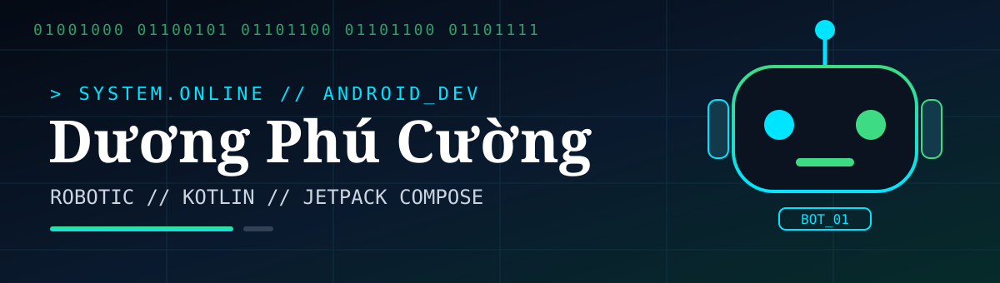

# Dương Phú Cường

### Android Developer — Kotlin · Jetpack Compose

---

## About

I'm an Android developer who focuses on the whole product, not just the code: a clear first screen, a smooth flow, and an app that stays fast as it grows.

**I focus on**

- **Product-first Android** — features that are actually useful, not just technically impressive
- **Modern UI** — Jetpack Compose, Material 3, and thoughtful motion
- **Solid engineering** — MVVM, clean architecture, and maintainable code
- **Performance** — fast startup, smooth lists, and efficient data handling

---

## Stack

**Languages**

**Android**

**Architecture & Data**

**Workflow**

---

## Right now

- Building Android apps with **Kotlin + Jetpack Compose**
- Using **MVVM and clean architecture** in real projects
- Working with **REST APIs and Room** for reliable offline-friendly data
- Polishing the details: UI states, loading, errors, and performance

---

## Projects

My Android projects are being curated here and will be added with real apps and real code only.

> Interested in collaborating on an Android project? Open an issue on this profile repo.

---

## GitHub

---

*Building Android, one thoughtful app at a time.*

