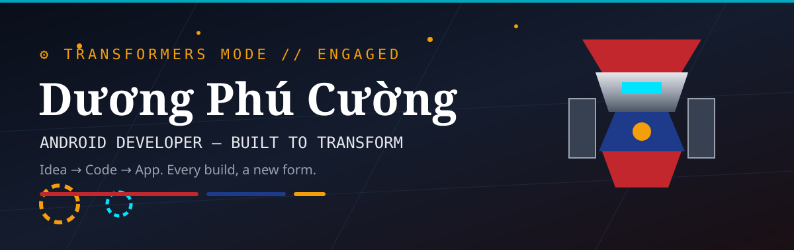
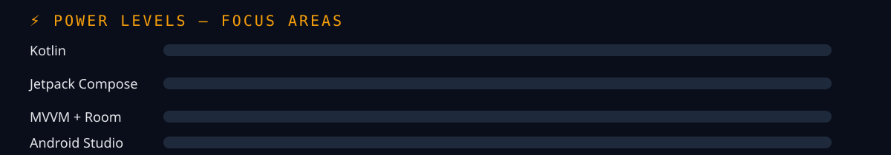

# ⚙️ DƯƠNG PHÚ CƯỜNG

## 🤖 ANDROID DEVELOPER — BUILT TO TRANSFORM

## 🔄 TRANSFORMATION SEQUENCE

| Stage | Form | What happens |
|---|---|---|
| **01** | 💡 IDEA | A real problem, a clear user need |
| **02** | 🧩 DESIGN | Clean UI, Material 3, intuitive flow |
| **03** | ⚙️ BUILD | Kotlin + Compose + MVVM, solid architecture |
| **04** | 🚀 DEPLOY | Tested, polished, and ready to ship |

<table>
<tr>
<td width="50%" valign="top">

## 🛡️ ARMOR — Core Stack

**Languages**
 

**Android UI**
 

**Data**
 

</td>
<td width="50%" valign="top">

## ⚔️ SYSTEMS — How I Work

- **Architecture:** MVVM + clean, modular code
- **UI:** Compose-first, Material 3, smooth motion
- **Data:** REST APIs, Room, offline-friendly flows
- **Quality:** Readable code, tested flows, stable releases
- **Performance:** Fast startup, smooth scrolling, efficient work

**Tools**
 

</td>
</tr>
</table>

## ⚡ POWER LEVELS

<table>
<tr>
<td width="50%" valign="top">

## 🎯 CURRENT MISSIONS

- Building Android apps with **Kotlin + Jetpack Compose**
- Applying **MVVM and clean architecture**
- Connecting apps to **APIs and Room**
- Polishing UI, performance, and stability

</td>
<td width="50%" valign="top">

## 🚀 PROJECT BAY

My Android projects are being curated here and will be added with real apps and real code only.

> Interested in collaborating? Open an issue on this profile repo.

</td>
</tr>
</table>

## 📡 TELEMETRY — GitHub Stats

  

  

### ⚙️ MORE THAN MEETS THE EYE.

